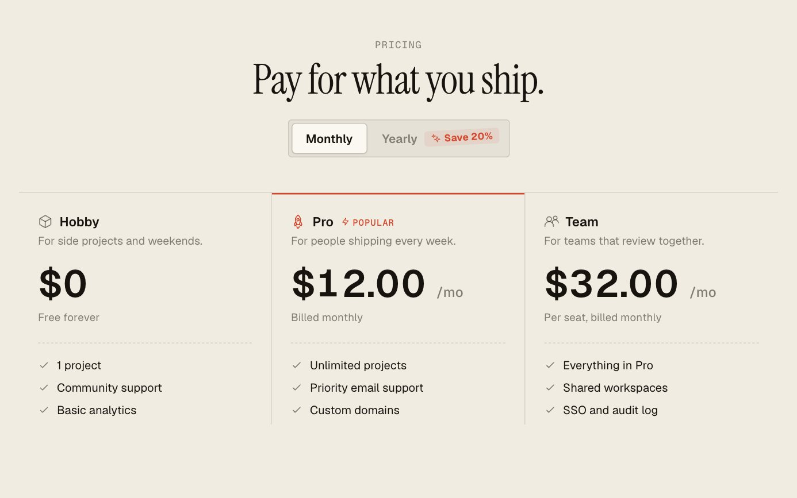
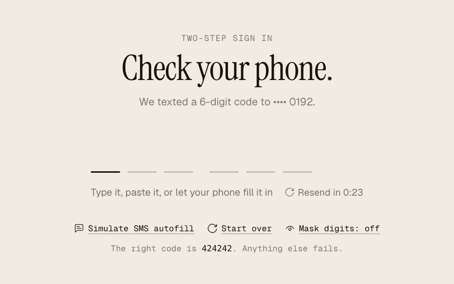
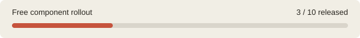

# Brio UI

React components with motion and the awkward edge cases handled. Copy one file. Make it yours.

[](LICENSE)
[](https://react.dev/)
[](https://github.com/brio-ui/brio-ui/tree/main/components)

| [Pricing Toggle](docs/pricing-toggle.md) | [Code Input](docs/code-input.md) | [FAQ](docs/faq.md) |
| --- | --- | --- |
| [](components/pricing-toggle/pricing-toggle.tsx) | [](components/code-input/code-input.tsx) | [](components/faq/faq.tsx) |
| [Source](components/pricing-toggle/pricing-toggle.tsx) · [Usage](docs/pricing-toggle.md#usage) | [Source](components/code-input/code-input.tsx) · [Usage](docs/code-input.md#usage) | [Source](components/faq/faq.tsx) · [Usage](docs/faq.md#usage) |



## Use it

In a React 19 project, copy a component from [components/](components) and install its dependency:

```bash
npm install motion
```

```tsx
import { Faq } from './components/faq'

<Faq items={[{ q: 'Can I change this?', a: 'Yes. The source is yours.' }]} />
```

TypeScript source. Styles included. No Tailwind or provider required.

Early release. These 3 components are [MIT licensed](LICENSE). Website docs and registry installs are rolling out; use the files here today.

[Brio UI](https://brioui.com/?utm_source=github&utm_medium=readme&utm_campaign=free-components) · [Report an issue](https://github.com/brio-ui/brio-ui/issues)
